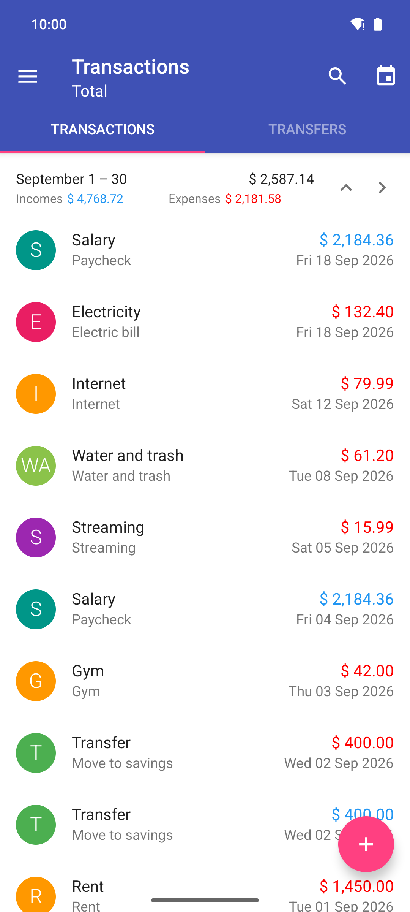
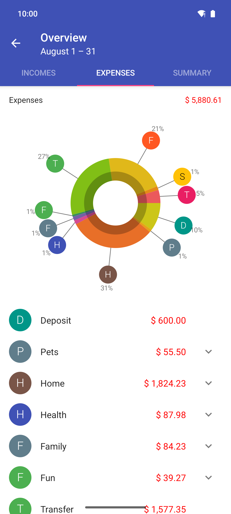
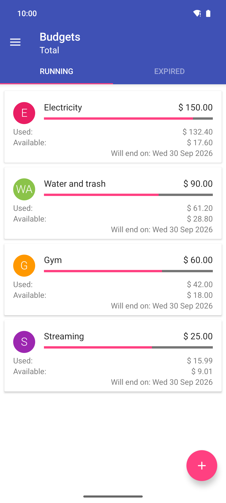
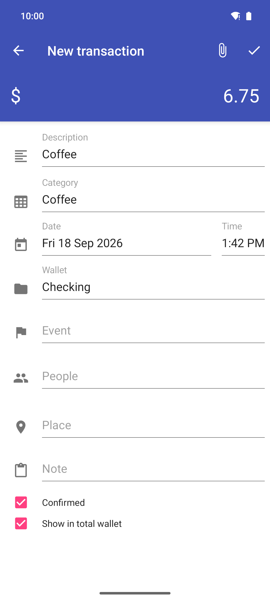

<div align="center">


# Tallybook

An expense and budget tracker for Android that keeps your money on your own phone.

[](https://www.gnu.org/licenses/gpl-3.0.html)
[](https://f-droid.org/packages/io.github.herrerad85.tallybook/)
[](https://github.com/herrerad85/tallybook/releases/latest)

[](https://f-droid.org/packages/io.github.herrerad85.tallybook/)

</div>

Tallybook tracks what you spend and what you have, across as many wallets as you keep. It runs with no network connection and asks for no account. [PRIVACY.md](PRIVACY.md) lists every way data leaves the app.

The F-Droid build is reproducible and carries the developer signature, so the app from F-Droid and the APK attached to each [release](https://github.com/herrerad85/tallybook/releases) are interchangeable.

<div align="center">




</div>

## What it does

- **Wallets.** Keep as many as you need, each in its own currency.
- **Categories.** Group spending into categories and subcategories, and open a category total into the ones underneath it.
- **Split transactions.** Spread one receipt over several categories and count each part where it belongs.
- **Search.** Find transactions by category, text, people, status, wallet, amount or date.
- **Budgets.** Set a limit for a period, cover more than one category with it, and let it repeat into the next period on its own. A spending budget's bar turns amber near the limit and red past it, and a repeating budget shows bars for its last three periods.
- **Recurring transactions.** Post on a schedule you set, including transfers between wallets.
- **Debts and savings goals.** Track what you owe, what you are owed, and what you are putting aside.
- **Reports.** See a period's income and spending, with charts by category.
- **Calendar.** A day strip marks the days that have transactions.
- **Widget.** A home screen widget shows one wallet's balance.
- **Automation.** Tasker and other automation apps can open a new transaction already filled in, or save one with no tap once you allow it.
- **Themes.** Light, Dark, Deep dark or following the phone, with colors from your wallpaper if you like.
- **Backup.** Write to a local folder, to your own WebDAV server such as Nextcloud or a NAS, or through Android's own backup.
- **Import and export.** CSV in, and CSV, XLS or PDF out, plus the older MoneyWallet backup file.
- **Lock.** An optional PIN, pattern or fingerprint when the app opens. While it is on, screenshots of the app come out black.

## Coming from MoneyWallet

Tallybook is a maintained fork of [MoneyWallet](https://github.com/AndreAle94/moneywallet), which last had a release in 2021. It is a separate app with its own application id, so it installs beside the original and does not replace it or carry its data across on its own. [MIGRATION.md](MIGRATION.md) has the path that was tested.

## Docs

- [Usage guide](https://herrerad85.github.io/tallybook/)
- [FAQ](docs/FAQ.md)
- [Adding transactions from another app](docs/AUTOMATION.md)
- [Moving from MoneyWallet](MIGRATION.md)
- [CSV import format](docs/CSV.md)
- [Privacy](PRIVACY.md)
- [Third party notices](THIRD_PARTY_NOTICES.md)

Every release note is on the [releases page](https://github.com/herrerad85/tallybook/releases).

## Build from source

Build the `floss` + `osm` flavors, which use OpenStreetMap and no proprietary services:

```
./gradlew assembleFlossOsmDebug
```

Requirements: a recent Android SDK and JDK 17 or newer. Release builds use JDK 21, which is what the F-Droid build server uses, so a release built on an older JDK will not reproduce.

## Contributing

Bug reports and pull requests are welcome in the [issue tracker](https://github.com/herrerad85/tallybook/issues). Current direction and open work live in the pinned [roadmap issue](https://github.com/herrerad85/tallybook/issues/15).

[CONTRIBUTING.md](CONTRIBUTING.md) has the bar a pull request is held to, including an AI written one, and the steps for translating.

## Credits and license

Tallybook is free software under the GNU General Public License v3.0 or later, the same license as the project it came from. See [LICENSE.md](LICENSE.md).

MoneyWallet was written by AndreAle94 and its contributors, and this fork exists to keep that work usable. Tallybook is independent and is not endorsed by or affiliated with the original author.

The app icon and the intro illustrations are original artwork for this fork, released under the GPLv3. The category picker icons place glyphs from Phosphor Icons (MIT), Tabler Icons (MIT), Lucide (ISC) and Bootstrap Icons (MIT) on original GPLv3 disc backgrounds, and a few are original artwork. The interface also uses Material Design Icons, licensed under Apache-2.0. Full license texts are in [THIRD_PARTY_NOTICES.md](THIRD_PARTY_NOTICES.md).
